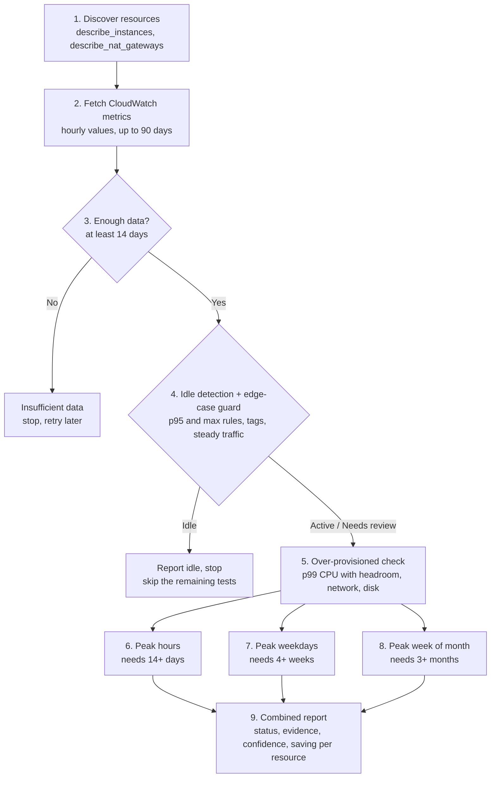

# Finding Idle, Over-Provisioned and Peak-Hour AWS Resources

Pipeline guide for EC2 instances and NAT Gateways: techniques, goals and worked numerical examples.

> **Scope note.** This version drops two parts of the original design: the separate **data preparation** step (resampling, gap interpolation) and **memory usage** (`mem_used_percent`). Both depend on extra setup, and memory in particular needs the CloudWatch agent installed on every instance. The pipeline below uses only metrics that AWS publishes by default, so it works on any account with a read-only role and nothing to install.

---

## 1. What the system does

The system reads a user's AWS account and answers three questions for every EC2 instance and every NAT Gateway:

- **Idle:** is the resource doing almost no useful work, so it could be stopped or deleted?
- **Over-provisioned:** is it much larger than its workload needs, so a smaller size would save money?
- **Peak pattern:** does it have regular busy hours, busy weekdays, or a busy week of the month?

All evidence comes from CloudWatch metrics history. Nobody knows in advance which condition applies to a given resource, so the system does not guess. **Every resource goes through the same ordered pipeline, and every test returns one of three statuses: `found`, `none` (enough data, nothing there) or `not_enough_data`.** This way nothing is silently skipped, and "no peak found" can never be confused with "not enough history".

> **Safety rule.** Low CPU does not automatically mean idle. Database replicas, standby servers and proxies also show low CPU. The pipeline labels uncertain cases "Needs review" instead of "Idle", and it never deletes or changes anything by itself.

## 2. Techniques and goals in one table

| No. | Name | Technique used | Goal |
|---|---|---|---|
| 1 | Discover resources | AWS API calls: `describe_instances`, `describe_nat_gateways`, `describe_route_tables` | Build the resource list and collect type, tags, launch time and routes |
| 2 | Fetch metrics | CloudWatch `get_metric_data`, hourly period, up to 90 days | Collect usage history: CPU, network, disk, NAT bytes and connections |
| 3 | Data sufficiency gate | Minimum-history rules (14 days, 4 weeks, 3 months) | Avoid conclusions drawn from too little data |
| 4 | Idle detection | Percentiles (p95, max) in a multi-signal rule, plus an edge-case guard (tags, steady traffic, age) | Find unused resources without wrongly flagging replicas or standbys |
| 5 | Over-provisioned check | p99 percentile right-sizing with headroom, plus network, disk and CPU-credit checks | Recommend a smaller size and estimate the monthly saving |
| 6 | Peak hours | Flat check, correlation check, percentile threshold, consistency ratio | Find hours of the day that are regularly busy |
| 7 | Peak weekdays | The same counting method on daily averages grouped by weekday | Find regularly busy days of the week |
| 8 | Peak week of month | The same counting method on weekly averages grouped by week of month | Find regularly busy weeks, such as month-end jobs |
| 9 | Report | Status model with stored evidence | Combine all results with confidence, evidence and saving |

## 3. The pipeline at a glance

Steps 1 and 2 collect the data, steps 3 and 4 are gates that can stop the run, and steps 6 to 8 are independent pattern tests that are combined in step 9.



A confidently idle resource skips the remaining tests because peaks and right-sizing mean nothing for an unused resource. A "Needs review" result (for example a replica) does **not** stop the run: the tag is carried forward, so the resource can still be checked for over-provisioning but is never called idle.

### Why percentiles instead of averages?

An average hides short spikes: a server at 1% for 23 hours and 90% for 1 hour has an average of about 4.7%, which looks idle, yet it clearly does real work. A **percentile** answers a better question. The 95th percentile (p95) is the value that 95% of the readings stay below, so it shows how busy the resource is during its busier moments without letting one freak reading decide the result. The maximum is used alongside it as a safety check.

---

## 4. Step-by-step: goal, technique and numerical examples

### Step 1: Discover resources

| | |
|---|---|
| **Goal** | Build the list of resources to analyse and collect the details later steps depend on. |
| **Technique** | AWS API calls using an assumed role (read-only): `ec2.describe_instances`, `ec2.describe_nat_gateways`, `ec2.describe_route_tables`. |

For each EC2 instance keep: instance ID, type (vCPU and memory size come from `describe_instance_types`), launch time, state, tags, and whether it belongs to an Auto Scaling group or a load-balancer target group. For each NAT Gateway keep: ID, subnet, and the list of route tables that point to it.

**Example:** `i-0abc123`, m5.2xlarge (8 vCPU, 32 GiB), launched 2026-08-01, tag `Role=api`.

### Step 2: Fetch CloudWatch metrics

| | |
|---|---|
| **Goal** | Collect the usage history that every later test is built on. |
| **Technique** | CloudWatch `get_metric_data` with a 3600-second (hourly) period, fetched once for up to 90 days and reused by all tests. |

| Resource | Namespace | Metrics | Statistic |
|---|---|---|---|
| EC2 | AWS/EC2 | CPUUtilization | Average and Maximum |
| EC2 | AWS/EC2 | NetworkIn, NetworkOut, EBSReadBytes, EBSWriteBytes | Sum |
| EC2 (T-family) | AWS/EC2 | CPUCreditBalance, CPUCreditUsage | Average |
| NAT Gateway | AWS/NATGateway | BytesOutToDestination, BytesInFromSource, ActiveConnectionCount | Sum (bytes), Maximum (connections) |
| NAT Gateway | AWS/NATGateway | ErrorPortAllocation, PacketsDropCount | Sum |

All of these are published by AWS by default; no agent is needed.

**Numerical example.** 90 days × 24 hours = 2,160 hourly points per metric. Fetching CPU Average and CPU Maximum gives 2 × 2,160 = 4,320 points for one instance. CloudWatch keeps 1-minute data for 15 days, 5-minute data for 63 days and 1-hour data for 455 days, which is why long histories must be fetched at an hourly period. Because the hourly period is requested directly, CloudWatch already returns one value per hour, so no separate resampling step is needed.

### Step 3: Data sufficiency gate

| | |
|---|---|
| **Goal** | Refuse to draw conclusions from too little history. |
| **Technique** | Minimum-history rules measured in days. Each test checks its own requirement. |

| Test | Minimum history | Reason |
|---|---|---|
| Whole pipeline, idle, over-provisioned, peak hours | 14 days | Two full weeks cover two of every weekday |
| Peak weekdays | 28 days (4 weeks) | Each weekday needs several repeats to be counted |
| Peak week of month | 90 days (3 months) | A monthly pattern needs several months to repeat |

**Example 1:** an instance launched 9 days ago stops here with `insufficient_data`.
**Example 2:** an instance with 40 days of history runs the idle, over-provisioned, peak-hour and peak-weekday tests, and reports `not_enough_data` for peak week of month.

### Step 4: Idle detection with the edge-case guard

| | |
|---|---|
| **Goal** | Find resources doing almost no work, without wrongly flagging replicas, standbys and other quiet but important resources. |
| **Technique** | A multi-signal rule on percentiles (p95 and maximum), followed by an edge-case guard that checks tags, steadiness of background traffic and resource age. |

**EC2 idle rule.** All of these must hold over the window: CPU p95 below 5%, CPU maximum below 10%, network in plus out below about 5 MB per day, and EBS read plus write close to zero. Using several signals together avoids calling a busy-but-low-CPU resource idle.

**Steadiness of traffic** is measured with the coefficient of variation: CV = standard deviation / mean of the hourly network bytes. A replica receives replication traffic all day, so its traffic is steady (small CV). Example: hourly network in MB = 38, 41, 40, 39, 42. Mean = 40, standard deviation = 1.41, so CV = 1.41 / 40 = 0.035. Anything under 0.5 is treated as steady.

**Worked example with three instances (14 days of data):**

| Signal | Instance A | Instance B | Instance C |
|---|---|---|---|
| CPU p95 | 3.2% | 2.0% | 35% |
| CPU maximum | 7% | 5% | 88% |
| Network per day | 1.2 MB | 960 MB (40 MB per hour) | 4.5 GB |
| Hourly traffic CV | not needed (almost no traffic) | 0.035 (steady) | 0.9 (varies a lot) |
| EBS write per day | 0 | 1.1 GB | 6 GB |
| Tag | none | Role=replica | Role=api |
| **Result** | **IDLE** (all signals near zero) | **NEEDS REVIEW** (low CPU but steady traffic and a replica tag) | **ACTIVE** |

**NAT Gateway idle rule.** Total `BytesOutToDestination` is 0 over the window, the maximum of `ActiveConnectionCount` is 0, and no route table points to the gateway (checked with `describe_route_tables`). A NAT Gateway costs about $0.045 per hour even with no traffic, so one idle gateway wastes roughly 730 × $0.045 = **$32.85 per month** (us-east-1 example price; check current pricing).

#### Edge cases the guard protects against

| Case | Why it looks idle | How the pipeline handles it |
|---|---|---|
| Database replica, standby, DR server | Low CPU, few queries | Steady background network or disk traffic, or a tag such as Role=replica, gives "Needs review" |
| Monthly or quarterly batch job | Quiet for weeks | Use a 60 to 90 day window; report the date of the last activity |
| Memory-bound app (cache, JVM, in-memory DB) | Low CPU, memory not measured | Memory is out of scope, so network and disk must also be near zero before "Idle"; otherwise "Needs review" |
| Proxy, bastion, VPN, load-balancer instance | Low CPU, high network | Network is part of the rule |
| Burstable T-family instance | Low CPU by design | Also check CPU credit balance and usage |
| DR or failover NAT Gateway | Almost no traffic but needed | Check tags and one-NAT-per-AZ design |
| Instance launched recently | Not enough history | Minimum age of 14 days, otherwise insufficient data |

### Step 5: Over-provisioned check

| | |
|---|---|
| **Goal** | Find resources that are larger than their workload needs, recommend a smaller size, and estimate the saving. |
| **Technique** | Percentile right-sizing: take the p99 of the hourly maximum CPU as the realistic worst case, add headroom, then verify network, disk and CPU credits still fit. |

**Formula:** needed vCPU = current vCPU × (p99 max CPU / 100) / target utilization, with target utilization = 0.70 so peaks keep 30% headroom. If needed vCPU is at most half of the current size, recommend one size down; at most a quarter, two sizes down. Stay in the same family and architecture to keep the change low-risk.

**Worked example: m5.2xlarge (8 vCPU, 32 GiB), p99 of hourly max CPU = 20%.**

| Step | Calculation | Result |
|---|---|---|
| CPU actually needed at worst | 8 vCPU × 0.20 | 1.6 vCPU |
| Add 30% headroom | 1.6 / 0.70 | 2.29 vCPU |
| Half of current size? | 2.29 is at most 4 (half of 8) | Yes, so at least one size down |
| Quarter of current size? | 2.29 is above 2 (quarter of 8) | No, so not two sizes down |
| Candidate | m5.xlarge: 4 vCPU, 16 GiB | Fits the CPU need |
| Network and disk check | Peak network 200 Mbps against a limit of up to 10 Gbps | Fits |
| Saving | $0.384 per hour to $0.192 per hour; 730 hours: $280.32 to $140.16 | About **$140 per month** |

Example prices are us-east-1 on-demand; real savings depend on region and any Savings Plans. Never downsize when the CPU credit balance of a burstable instance is near zero (it is already starved).

**Memory is not checked.** Because memory usage is out of scope, every right-sizing recommendation is reported with **medium confidence** and the note "verify memory before resizing". Staying in the same family keeps the vCPU-to-memory ratio fixed, which limits the risk, and AWS Compute Optimizer `get_ec2_instance_recommendations` can be shown as an independent cross-check.

**NAT Gateway.** A NAT Gateway scales automatically, so it cannot be "too big". Over-provisioning means several gateways in one VPC each carrying very little traffic (review only, because one NAT per Availability Zone can be a deliberate resilience choice). If `ErrorPortAllocation` or `PacketsDropCount` is above 0, the gateway is under stress and is never flagged.

### Step 6: Peak hours

| | |
|---|---|
| **Goal** | Find the hours of the day that are regularly busy, and ignore one-off spikes. |
| **Technique** | Flat check (is there any shape?), correlation check (is there a daily pattern?), percentile threshold (what counts as high?), then the consistency ratio (how often was each hour high?). |

Before grouping, timestamps are shifted from UTC to the user's local time zone. A reading stamped 04:00 UTC is 09:00 in Pakistan (UTC+5); without this, a 9 AM office peak would be reported at 4 AM. This is a single line at grouping time, not a separate preparation step.

**Flat check.** If the standard deviation is below 5% of the mean, the series has no real shape and no peak can exist. Example: mean 40, standard deviation 1.4, so 1.4 / 40 = 3.5%, which is below 5%, so the series is flat and the peak tests report `none`.

**The counting method** (reused in steps 7 and 8): (a) turn the data into one number per time unit; (b) set a "high" line from the resource's own data with a percentile; (c) mark which readings are above the line; (d) group by the label you care about and compute the fraction of times each group was high; (e) keep groups whose fraction is at least 0.6. Think of rush hour: 5 PM is a rush hour because it is jammed on most days, not because of one accident.

**Worked example** (8 working hours over 5 days, CPU %; real data uses 24 hours and 14 or more days). Values marked **bold** are at or above the high line of 64.25 computed below.

| Hour | Mon | Tue | Wed | Thu | Fri | Days high | Ratio |
|---|---|---|---|---|---|---|---|
| 08:00 | 10 | 12 | 9 | 11 | 10 | 0 of 5 | 0.0 |
| 09:00 | 14 | 15 | 13 | 16 | 12 | 0 of 5 | 0.0 |
| 10:00 | 40 | 38 | 42 | 36 | 41 | 0 of 5 | 0.0 |
| 11:00 | **66** | **70** | **68** | **72** | **69** | 5 of 5 | **1.0** |
| 12:00 | **65** | **67** | **66** | 64 | **68** | 4 of 5 | **0.8** |
| 13:00 | 33 | 30 | 35 | 31 | 34 | 0 of 5 | 0.0 |
| 14:00 | 12 | 11 | 13 | **85** | 10 | 1 of 5 | 0.2 |
| 15:00 | 10 | 9 | 8 | 10 | 9 | 0 of 5 | 0.0 |

- **(a) Is there a daily pattern?** Correlation between Monday and Tuesday = 0.996 (1 means identical shape, 0 means no relationship). Anything above about 0.3 means days resemble each other, so a pattern exists and we continue. Below 0.3 we stop and report `none`.
- **(b) Set the high line.** The 40 readings sorted from the top are 85, 72, 70, 69, 68, 68, 67, 66, 66, 65, 64, and so on. We expect about 2 busy hours out of 8, which is 25%, so we use the 75th percentile. The 10th highest value is 65 and the 11th is 64, so the line sits a quarter of the way between them: **64.25**. With 24-hour data and a peak of 2 to 3 hours, the 90th percentile is used instead.
- **(c) and (d) Mark and count.** A reading of 64.25 or more is high. Hour 11:00 was high on 5 of 5 days (ratio 1.0). Hour 12:00 was high on 4 of 5 days (ratio 0.8), because Thursday's 64 is just under the line. Hour 14:00 was high on 1 of 5 days (ratio 0.2).
- **(e) Consistency rule.** Keep hours with a ratio of at least 0.6. Hours 11 and 12 pass; hour 14 fails.
- **(f) Merge neighbours.** Hours 11 and 12 are adjacent, so the result is the window **11:00 to 13:00**.

> **Why Thursday's 85 is ignored.** It is the largest number in the table, but it appeared on only 1 of 5 days (ratio 0.2), so it fails the consistency rule. This is how a one-off backup or deployment spike is kept out of the peak-hour result.

**Missing hours.** Gaps are not filled. Missing readings are simply left out of the count, so a ratio is "high days / days with data". If more than 20% of the hours are missing, the result's confidence is lowered.

### Step 7: Peak weekdays

| | |
|---|---|
| **Goal** | Find the days of the week that are regularly busy. |
| **Technique** | The same counting method, applied to one average value per day and grouped by day of week. Needs at least 4 weeks. |

**Worked example:** daily average CPU % over 4 weeks (a weekly report job runs on Mondays).

| Week | Mon | Tue | Wed | Thu | Fri | Sat | Sun |
|---|---|---|---|---|---|---|---|
| Week 1 | **78** | 35 | 33 | 36 | 34 | 12 | 10 |
| Week 2 | **80** | 33 | 36 | 34 | 35 | 11 | 9 |
| Week 3 | **76** | 37 | 34 | 35 | 33 | 13 | 12 |
| Week 4 | **79** | 34 | 35 | 37 | 36 | 10 | 11 |
| Weeks high | 4 of 4 | 0 of 4 | 0 of 4 | 0 of 4 | 0 of 4 | 0 of 4 | 0 of 4 |
| Ratio | **1.0** | 0.0 | 0.0 | 0.0 | 0.0 | 0.0 | 0.0 |

- **High line.** Monday is 1 of 7 days, about 14% of the week, so we use the 100 − 14.3 = 85.7th percentile of the 28 values. The line is **42.57**, which sits in the gap between the four Mondays (76 to 80) and every other day (37 or lower).
- **Count and keep.** Mondays were high in 4 of 4 weeks (ratio 1.0). Every other weekday has ratio 0.0. Result: **Monday is a busy day.** If only one Monday had been high, its ratio would be 0.25 and it would be ignored.

### Step 8: Peak week of month

| | |
|---|---|
| **Goal** | Find regularly busy weeks inside a month, such as month-end billing or reporting jobs. |
| **Technique** | The same counting method, applied to one average per week and grouped by week of month (days 1 to 7 = week 1, and so on). Needs at least 3 months, preferably 4. |

**Worked example:** weekly average CPU % over 4 months.

| Month | Week 1 | Week 2 | Week 3 | Week 4 |
|---|---|---|---|---|
| Jan | 30 | 31 | 29 | **71** |
| Feb | 32 | 30 | 33 | **74** |
| Mar | 29 | 33 | 30 | **69** |
| Apr | 31 | 30 | 32 | **72** |
| Months high | 0 of 4 | 0 of 4 | 0 of 4 | 4 of 4 |
| Ratio | 0.0 | 0.0 | 0.0 | **1.0** |

- **High line.** One busy week out of 4 is 25%, so the 75th percentile of the 16 values is used. It is **42**, between the busy weeks (69 to 74) and the normal weeks (33 or lower).
- **Result.** Week 4 (days 22 to 28) was high in 4 of 4 months (ratio 1.0), so it is a busy week every month, which fits month-end processing. With fewer than 3 months the system reports `not_enough_data`, because a monthly pattern cannot be told apart from a one-time event. Days 29 to 31 form a tiny partial week and are merged into week 4.

#### Summary of the settings that change between steps 6, 7 and 8

| Test | One number per | Group by | Count over | Expected busy share | High line |
|---|---|---|---|---|---|
| Peak hours | hour | hour of day | days | about 10% (2 to 3 of 24 hours) | 90th percentile |
| Peak weekdays | day | day of week | weeks | 1 / 7 | 85.7th percentile |
| Peak week of month | week | week of month | months | 1 / 4 = 25% | 75th percentile |

### Step 9: Combine into one report

| | |
|---|---|
| **Goal** | Give the user one clear result per resource, with the evidence behind every statement. |
| **Technique** | A status model: each test stores `found`, `none` or `not_enough_data`, together with the numbers it used (thresholds, ratios, percentiles). |

Illustrative output for one resource (values combine the earlier examples):

```text
Resource: i-0abc123 (m5.2xlarge)     History: 90 days
idle ................ ACTIVE
over_provisioned .... YES    p99 max CPU 20%   recommend m5.xlarge   saving about $140 per month   confidence: medium (memory not checked)
peak_hours .......... FOUND  11:00-13:00       high on 5 of 5 days
peak_weekdays ....... FOUND  Monday            high in 4 of 4 weeks
peak_week_of_month .. FOUND  week 4            high in 4 of 4 months
```

Showing the evidence (percentile values, ratios, data length) next to each result lets a user see why a decision was made, which is what makes the tool trustworthy. Peak windows also feed practical actions: scheduled scaling, stopping dev or test instances outside working hours, or planning around batch windows.

---

## 5. Technique glossary

| Technique | What it does in plain words | Used in step |
|---|---|---|
| Percentile (p95, p99) | The value that 95% (or 99%) of readings stay below; ignores freak readings | 4, 5, 6, 7, 8 |
| Coefficient of variation | Standard deviation divided by mean; small means steady, large means jumpy | 4, 6 |
| Multi-signal rule | Requires several metrics to agree before a label is given | 4 |
| Tag and metadata check | Reads tags, Auto Scaling and route-table links to spot protected resources | 4 |
| Headroom sizing | Adds a safety margin (target 70% use) when choosing a smaller size | 5 |
| Correlation (autocorrelation) | Measures how similar two days are; high means a repeating pattern | 6 |
| Consistency ratio | Fraction of days (weeks, months) a slot was high; filters one-off spikes | 6, 7, 8 |

## 6. Edge cases in the peak tests

| Case | Problem | Handling |
|---|---|---|
| Time zone | Peaks appear at the wrong hour | Convert from UTC to local time when grouping |
| Missing data | Gaps distort counts | Count only hours with data; more than 20% missing lowers confidence |
| Flat usage | Noise looks like a pattern | Flat check before any peak test |
| Scheduled job (for example a 02:00 backup) | A real, regular peak that is not user traffic | Report it as a scheduled window |
| Public holidays | A quiet Monday lowers the ratio | Ratio threshold of 0.6 instead of 1.0 leaves room for misses |
| Weekday and weekend differ | One profile hides both | Run the profile separately for weekdays and weekends |
| Static baseline | A new campaign changes behaviour | Recalculate regularly; the history window rolls forward |

## 7. Default settings (all configurable)

| Setting | Default | Used in |
|---|---|---|
| Idle: CPU p95 and CPU maximum | below 5% and below 10% | Step 4 |
| Idle: network per day | below about 5 MB; EBS close to zero | Step 4 |
| Steady traffic (CV) | below 0.5 | Step 4 |
| Target utilization for right-sizing | 0.70 | Step 5 |
| Flat series | standard deviation below 5% of mean | Step 6 |
| Minimum history | 14 days; 28 days; 90 days | Steps 3, 6, 7, 8 |
| Daily-pattern correlation | at least 0.3 | Step 6 |
| Consistency ratio | at least 0.6 | Steps 6, 7, 8 |
| Missing data before lower confidence | more than 20% | Step 6 |

Thresholds are starting points. Tuning them on test data and justifying the final values is a good result to report.

## 8. How to test that the pipeline is correct

Build fake resources whose correct answer you already know, run the pipeline, and check that it finds exactly that. Write one automated test per row.

| Fake resource | How to build it | Expected result |
|---|---|---|
| Idle | CPU near 1%, network near 0, 30 days | Idle |
| Replica | CPU near 1%, steady small network, tag Role=replica | Needs review, not idle |
| Over-provisioned | Large instance, CPU between 5% and 15% | Over-provisioned, one size down, medium confidence |
| Daily peak | CPU 70% from 10:00 to 13:00, 15% otherwise | Peak hours 10 to 13 |
| Weekday peak | CPU 80% on Mondays only | Peak weekday: Monday |
| Month-end peak | CPU 75% on days 22 to 28, 90 days of data | Peak week of month: week 4 |
| One-off spike | Flat 20% with one spike to 95% | No peak found |
| Too little data | 5 days of history | Insufficient data |

```python
import numpy as np, pandas as pd

def fake_hourly(days=30, base=15, noise=2):
    idx = pd.date_range("2026-01-01", periods=days * 24, freq="h", tz="UTC")
    return pd.Series(base + np.random.randn(len(idx)) * noise, index=idx)

def test_daily_peak():
    s = fake_hourly()
    s[(s.index.hour >= 10) & (s.index.hour < 13)] += 55      # inject a 10:00-13:00 peak
    result = analyze("fake", s, tags={}, tz="UTC")
    assert result["tests"]["peak_hours"]["hours"] == [10, 11, 12]

def test_one_off_spike():
    s = fake_hourly(base=20)
    s.iloc[100] = 95                                          # single spike
    result = analyze("fake", s, tags={}, tz="UTC")
    assert result["tests"]["peak_hours"]["status"] == "none"
```

After the synthetic tests pass, compare the output on a few real resources with what the account owner knows about them.

## 9. Limits and optional upgrades

- **Limits.** The profile is a historical baseline and does not predict sudden flash crowds. Memory is not measured, so memory-heavy workloads may be marked "Needs review" or get a medium-confidence right-sizing result. NAT destination analysis would need VPC Flow Logs. Prices vary by region and discount plans.
- **Memory (future work).** If a user installs the CloudWatch agent, `mem_used_percent` can be added to the idle rule and the right-sizing check to raise confidence to high. The pipeline does not depend on it.
- **168-slot weekly profile.** Group by weekday and hour together (7 × 24 = 168 slots) to report windows like "Monday 09:00 to 11:00". Prefer 8 or more weeks of data.
- **STL decomposition.** Splits an hourly series into trend, repeating daily shape and noise, so slow growth does not distort the peak test.
- **Cross-checks.** Compare right-sizing results with AWS Compute Optimizer in the report.

## Appendix: code skeleton of the whole pipeline

The helper `peaks_by_group` is the counting method. Only its inputs change between steps 6, 7 and 8.

```python
def peaks_by_group(values, groups, expected_share, min_ratio=0.6):
    threshold = values.quantile(1 - expected_share)           # the "high" line from the data itself (NaN skipped)
    high = (values >= threshold).where(values.notna())        # mark high readings; missing hours stay NaN and are not counted
    ratio = high.groupby(groups).mean()                       # fraction of times each group was high
    return ratio[ratio >= min_ratio].index.tolist()           # keep consistent groups only

def is_flat(s):
    return s.std() < 0.05 * max(s.mean(), 1e-9)

def analyze(resource_id, hourly, tags, tz="Asia/Karachi"):
    report = {"id": resource_id, "tests": {}}
    days = (hourly.index[-1] - hourly.index[0]).days

    if days < 14:                                             # step 3: data gate
        report["status"] = "insufficient_data"
        return report

    idle = classify_idle(hourly, tags)                        # step 4: IDLE / NEEDS_REVIEW / ACTIVE
    report["tests"]["idle"] = idle
    if idle == "IDLE":
        return report

    report["tests"]["over_provisioned"] = check_overprovisioned(hourly)   # step 5 (medium confidence)

    local = hourly.tz_convert(tz)                             # local time for grouping only

    # step 6: peak hours
    if is_flat(local) or local.autocorr(lag=24) < 0.3:
        report["tests"]["peak_hours"] = {"status": "none"}
    else:
        hrs = peaks_by_group(local, local.index.hour, expected_share=0.10)
        report["tests"]["peak_hours"] = {"status": "found" if hrs else "none", "hours": hrs}

    # step 7: peak weekdays
    daily = local.resample("1D").mean()
    if len(daily) < 28:
        report["tests"]["peak_weekdays"] = {"status": "not_enough_data"}
    elif is_flat(daily):
        report["tests"]["peak_weekdays"] = {"status": "none"}
    else:
        wd = peaks_by_group(daily, daily.index.dayofweek, expected_share=1 / 7)
        report["tests"]["peak_weekdays"] = {"status": "found" if wd else "none", "days": wd}

    # step 8: peak week of month
    if days < 90:
        report["tests"]["peak_week_of_month"] = {"status": "not_enough_data"}
    else:
        g = [daily.index.to_period("M"), ((daily.index.day - 1) // 7 + 1).clip(upper=4)]
        wk = daily.groupby(g).mean()
        wom = peaks_by_group(wk, wk.index.get_level_values(1), expected_share=0.25)
        report["tests"]["peak_week_of_month"] = {"status": "found" if wom else "none", "weeks": wom}
    return report

reports = [analyze(r.id, r.hourly_cpu, r.tags) for r in resources]   # every resource, same path
```

---

## Final point

The final pipeline has **9 steps** and needs **only a read-only IAM role**: no agent, no installs, no changes to the user's resources. It runs every EC2 instance and NAT Gateway through the same path: **discover → fetch hourly CloudWatch metrics → check there is enough history → idle test → right-sizing test → three peak tests → one evidence-backed report.**

Three ideas carry the whole design:

1. **Percentiles, not averages.** p95 and p99 show real busy-time load without being fooled by one spike or hidden by a long quiet period.
2. **Several signals must agree, and uncertain cases go to "Needs review".** CPU, network, disk, tags and traffic steadiness are checked together, so replicas and standbys are never called idle.
3. **Count how often, not how big.** A peak hour, day or week must be high on at least 60% of occasions, so one-off spikes never become patterns.

Leaving out memory and the separate data-preparation step was a deliberate trade-off: the tool works on any AWS account immediately, at the cost of reporting right-sizing with medium confidence and a "verify memory before resizing" note. Every result states what it found, the numbers behind it, and how confident it is, so the user stays in control of every action.
